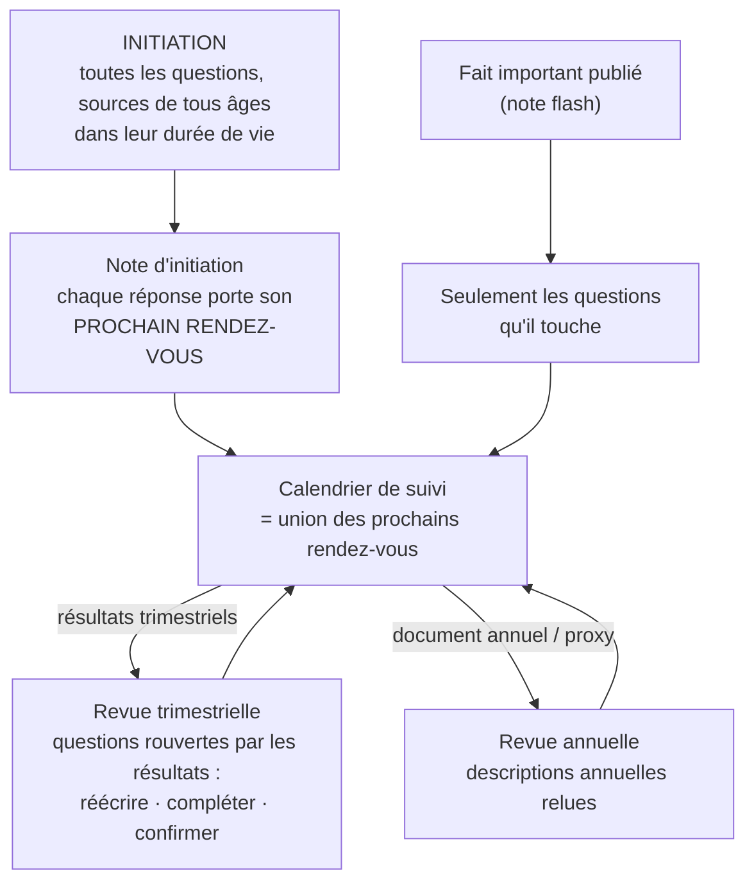

# La fraîcheur d'une réponse — proposition

## 1. Ce qui a déclenché la question (mesuré le 2026-10-16)

- **RVMD, management** (réponses #1451-#1456) : ma_1, ma_2, ma_3 sont **nées périmées** le jour même
  où elles ont été écrites.
- **NVDA, management** : le plan de collecte a été **refusé** (garde #123) — 7 lignes demandaient le
  rapport annuel de janvier pour reconstituer cinq ans de rachats, d'acquisitions et de promesses ;
  après renvoi, le modèle les a redemandées. Rien n'a été écrit.

La cause est la même dans les deux cas. Aujourd'hui :

1. **Ce qui rouvre une question est propre à la question** (`rouverte_par`, arbitrage du 26/09) :
   les résultats rouvrent ma_1, un changement de dirigeant rouvre ma_4 — c'est juste.
2. **Une réponse prend la date de sa pièce LA PLUS ANCIENNE** (règle anti-blanchiment : on ne
   rajeunit pas une analyse en y ajoutant une pièce récente).
3. Elle est **périmée** si un fait qui la rouvre est postérieur à cette date (pour les résultats :
   postérieur à la clôture qu'ils publient, #102).

Conséquence : toute question rouverte par les résultats trimestriels doit être **entièrement
refondée sur des pièces du dernier trimestre**, chaque trimestre. Pour un solde de trésorerie, c'est
juste. Pour un **historique** (« les rachats des cinq dernières années ont-ils été faits au bon
prix ? », « les acquisitions passées ont-elles rapporté ? »), c'est faux : le 10-Q de juillet ne
reprend pas l'histoire de Mellanox, et la citer depuis le rapport annuel suffit à périmer la note.
Même défaut, déjà rencontré et contourné au cas par cas : la série pluriannuelle du modèle économique
(#123, résolue en la lisant dans le modèle des comptes), les descriptions juridiques (arbitrage du
13/10, non construit).

> **Analogie** : aujourd'hui, le dossier traite un **livre d'histoire** comme un **journal du jour** —
> dès qu'un nouveau journal paraît, tout ce qui cite un ancien journal est jeté, y compris le chapitre
> d'histoire qui, lui, n'a pas changé.

## 2. Ce que fait un vrai fonds

- **À l'initiation**, l'analyste lit tout : cinq à dix rapports annuels, le dernier proxy, les
  derniers trimestriels, l'historique des acquisitions. La note d'initiation cite des documents de
  tous âges ; elle est « à jour » parce qu'elle **intègre la dernière publication**, pas parce que
  toutes ses sources sont récentes.
- **Chaque trimestre** (revue trimestrielle, arbitrage du 22/09), l'analyste met à jour le **modèle
  des comptes**, ajoute **une ligne** à l'historique (rachats du trimestre, objectifs tenus ou non),
  et **relit chaque section rouverte** : soit il la **réécrit**, soit il écrit « **inchangé** — la
  publication du … ne modifie pas ce point parce que … ». Il ne réécrit pas la gouvernance après
  des résultats.
- **Une fois par an**, il relit ce qui se publie une fois par an : rapport annuel (description des
  brevets, des contrats de dette, des risques), proxy (rémunération, conseil, contrôle). C'est la
  **revue annuelle** (le mode 6 de la spec V2 en fait « la colonne vertébrale » du suivi long terme).
- **Entre deux**, un fait important (approbation, acquisition, départ du directeur général) donne une
  **note flash** qui rouvre seulement ce qu'il touche (déjà construit, #89/#90).
- À chaque section, il sait **quand il devra la revoir** : « prochaine revue : résultats du T3
  (novembre) », « prochain proxy (avril 2027) ». C'est son calendrier de suivi.

## 3. La proposition, en trois règles

### Règle 1 — La durée de vie se déclare par INGRÉDIENT, pas par question (ni uniforme)

Une même question mélange des matières qui vieillissent différemment : ma_1 demande la répartition
**actuelle** des usages de la trésorerie (vieillit chaque trimestre) **et** leur rendement sur
plusieurs années (un historique qui ne vieillit pas, il s'allonge). Le référentiel déclarerait donc,
pour chaque ingrédient, l'une de quatre durées de vie :

| Durée de vie | Ce que c'est | Remplacée par… | Exemples |
|---|---|---|---|
| **Chiffre courant** | un solde, un flux de la dernière période | les comptes suivants | trésorerie, rachats du dernier semestre, marge des douze derniers mois |
| **Historique** | des faits passés, datés, qui ne changent pas | rien — on y **ajoute** la période nouvelle | rachats des 5 derniers exercices, acquisitions passées et leur prix, objectifs annoncés en 2024 et tenus ou non |
| **Description annuelle** | ce qui ne se publie qu'une fois par an | le document annuel suivant, ou un fait qui la **touche** | brevets, clauses des contrats de dette, rémunération des dirigeants, composition du conseil, contrôle des droits de vote |
| **Jugement** | la conclusion de l'analyste | un fait qui rouvre la question (inchangé : `rouverte_par`) | « la barrière s'élargit », « la direction tient parole » |

Une pièce reste **valable tant qu'elle est dans sa durée de vie**. La règle anti-blanchiment est
gardée, mais elle porte sur la bonne chose : on ne peut pas citer un **chiffre courant** périmé (le
solde de trésorerie de décembre après les comptes de juin) ; on peut citer un **historique** de tout
âge. Une description annuelle cède devant le document annuel suivant (ou devant un fait qui la touche :
la nomination d'un administrateur périme la composition du conseil, pas la rémunération).

### Règle 2 — Une question rouverte n'exige pas une réécriture : elle exige une REVUE

Quand un fait rouvre une question, la réponse passe « **à revoir** » (et non « fausse »). L'analyste a
trois gestes, tous datés et tracés :

- **réécrire** (la publication change la réponse) ;
- **compléter** (ajouter la période nouvelle à l'historique, la conclusion tient) ;
- **confirmer** : « inchangé — la publication du 26/08 ne modifie pas ce point parce que … ».

Une réponse est **à jour** si elle a été **écrite ou confirmée après** le dernier fait qui la rouvre,
**et** si chacune de ses pièces est dans sa durée de vie. La confirmation est le prolongement de ce
qui existe déjà pour un fait postérieur aux comptes (« lire et annoter », #117) : elle doit **citer la
publication** qu'elle déclare avoir lue — une confirmation qui ne nomme pas la publication est refusée
(garde de forme, comme #103/#117 ; elle ne garantit pas que l'analyste a bien lu, cf. §5).

### Règle 3 — Deux modes : l'initiation construit, le suivi revoit selon un calendrier

- **Initiation** : toutes les questions doivent avoir une réponse ou un « non fondé » nommé. Les
  pièces de tous âges sont admises dans leur durée de vie ; ce qui est exigé, c'est d'avoir **intégré
  la dernière publication** de chaque question (la garde #123 devient : « une ligne de chiffre courant
  ne vise pas un rapport antérieur à la dernière clôture » — elle ne refuse plus un historique).
- **Suivi** : seules les questions rouvertes sont revues, par le geste le moins lourd qui suffit.
- **Le calendrier** : à l'écriture, chaque réponse reçoit son **prochain rendez-vous**, dérivé de ses
  ingrédients (chiffre courant → prochains résultats ; description annuelle → prochain proxy ou
  rapport annuel ; jugement → aucun rendez-vous fixe, seulement les faits qui le rouvrent). C'est ce
  qui alimente le calendrier de suivi « défini à chaque fois qu'on recherche des informations ».

## 4. Exemples concrets

**NVDA, ma_3 « rachats et émissions au bon prix ? »** (initiation en octobre 2026)
- Rachats des exercices 2022-2026 et prix moyens → **historique** → cités du rapport annuel de
  janvier : valables. Rachats du semestre clos le 26/07 → **chiffre courant** → cités du 10-Q.
- Prochain rendez-vous : résultats du T3 (fin novembre). Ce jour-là, la réponse passe « à revoir » ;
  l'analyste **complète** (rachats du T3 au prix du T3) ou **confirme**. Le rapport annuel de janvier
  2027 remplacera alors la ligne « exercice 2026 » de l'historique (un exercice clos n'est pas réécrit,
  il est publié une fois).

**RVMD, ma_6 « le conseil est-il un contre-pouvoir ? »**
- Composition du conseil, droits de vote → **description annuelle** (proxy 2026) ; jugement.
- Rouverte par un changement de gouvernance (8-K 5.02). Prochain rendez-vous : proxy 2027. Les
  résultats d'août ne la touchent pas — c'est déjà le cas aujourd'hui.

**RVMD, qf_7 « autonomie de trésorerie »** — inchangé : tout est **chiffre courant**, les résultats
trimestriels imposent une nouvelle mesure (ou une confirmation si rien n'a bougé, ce qui est rare).

## 5. Le coût d'erreur, nommé

- **Une confirmation de complaisance** (l'analyste — un modèle — écrit « inchangé » sans avoir lu) :
  elle ne se voit qu'à la relecture. Garde de forme : elle cite la publication et dit en une phrase ce
  qu'elle y a vérifié. Repli possible (principe n° 3, ordre 1 débrayable) : un interrupteur qui
  interdit la confirmation et impose la réécriture — c'est la règle d'aujourd'hui.
- **Une durée de vie mal déclarée** (un chiffre courant classé « historique ») laisserait un solde
  périmé passer pour à jour. Remède de données (le référentiel se relit ingrédient par ingrédient,
  comme `rouverte_par`) ; prudence par défaut : un ingrédient **sans** déclaration est « chiffre
  courant » (la règle d'aujourd'hui).
- **Un historique qu'on oublie de compléter** : la confirmation sans complément laisserait le
  trimestre manquer. Pour les ingrédients « historique », la revue trimestrielle exige « compléter »
  ou un motif (« aucun rachat ce trimestre »).

## 6. Questions à trancher

1. **La durée de vie déclarée par ingrédient** (quatre catégories) vous convient-elle, ou préférez-vous
   une règle plus simple (deux catégories : « courant » / « durable ») ?
2. **La confirmation motivée** (« inchangé, parce que … ») vaut-elle mise à jour, ou toute question
   rouverte doit-elle être réécrite ?
3. **Le rythme du suivi** : la spec V2 faisait de la **revue annuelle** la colonne vertébrale (les
   revues trimestrielles n'escaladent que sur franchissement de seuil) ; l'arbitrage du 22/09 dit
   « publication trimestrielle = revue complète de la thèse ». Lequel fait foi pour les questions de
   **jugement** non touchées par les chiffres du trimestre ?
4. **Le prochain rendez-vous par réponse** alimente-t-il le calendrier de suivi (modes trimestriel /
   annuel), ou le calendrier reste-t-il fixé par la thèse validée ?

## 7. Esquisse de mise en œuvre (après arbitrage — ordre données → règle → agents)

1. Données : `duree_de_vie` sur chaque ingrédient de `frameworks.yaml` (requis, sans défaut — une
   absence se lit « chiffre courant » seulement si on le décide explicitement) ; relecture des six
   frameworks ingrédient par ingrédient avec l'utilisateur.
2. Règle de lecture (`servir_answer`) : chaque pièce jugée dans sa durée de vie ; la date de la réponse
   devient « écrite ou confirmée le » ; recalculée à la lecture (#53), rien de stocké.
3. Garde du traducteur (#123) : ne vise plus que les ingrédients « chiffre courant ».
4. Geste de revue (confirmer / compléter / réécrire) : contrat + pont (la confirmation cite la
   publication) + interrupteur de repli.
5. Prochain rendez-vous dérivé, servi par réponse ; branchement au calendrier selon la réponse à Q4.
6. Acceptation : RVMD ma_1-ma_3 à jour sans réécriture ; NVDA plan management admis et à jour ;
   test négatif : un solde de trésorerie de décembre cité après les comptes de juin reste périmé.
