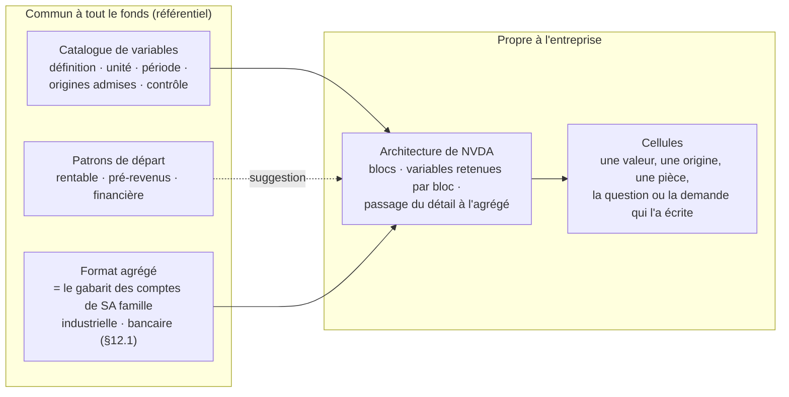
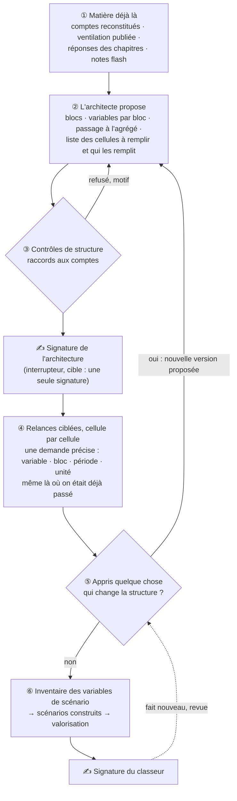
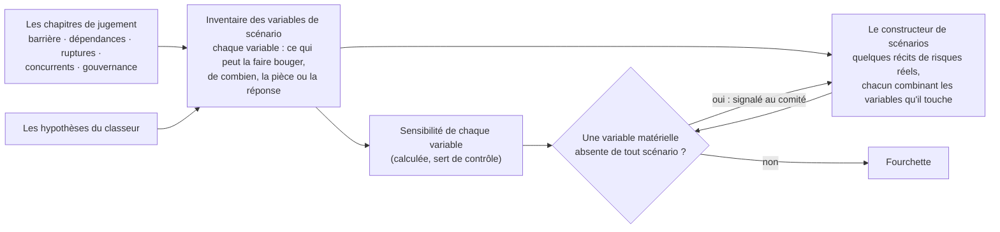
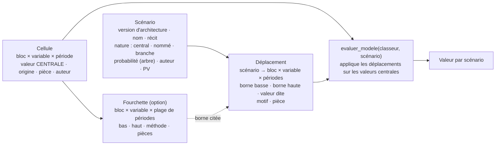

# Le modèle de l'entreprise — spec B1 (v2)

> Orientation de l'utilisateur (2026-10-19) : « un outil unique, le modèle de l'entreprise, avec autant
> d'onglets que nécessaire pour une modélisation complète ; chaque question de chaque framework y inscrit
> les informations pertinentes ; il sert à la fin à la valorisation ; il se remplit dans le BON ORDRE car
> les questions ultérieures dépendent de décisions de structuration prises en amont ; vérification qualité
> ad hoc à chaque étape ; puis signature globale du tableau, voire analyse de sensibilité ».
> Exigence du 2026-10-21 : l'architecture se réplique sur des entreprises très différentes.

## 0. Ce que ferait un vrai fonds

L'analyste ne remplit pas un gabarit figé : il **bâtit le classeur de l'entreprise** à partir de ce qu'il en
sait déjà (comptes, segments publiés, premières lectures), avec les briques maison du fonds (définitions
communes d'un marché, d'une part prise, d'une probabilité de succès…). Le directeur de la recherche valide
l'architecture ; l'analyste repart alors chercher, cellule par cellule, ce qui manque — **y compris là où il
croyait être déjà passé**. Le classeur est **vivant** : il se complète au fur et à mesure qu'on apprend sur
l'entreprise. Il montre l'historique et la projection **dans le même format que les comptes publiés**. Les
scénarios ne sont pas une grille de sensibilités : ce sont **quelques récits de risques réels**, choisis
parce qu'ils bougent la valeur de façon matérielle.

## 1. Arbitrages rendus le 2026-10-21 (sur la v1)

1. **Le gabarit est créé par un agent dédié, l'architecte**, propre à chaque entreprise, qui travaille
   avec en contexte les informations déjà récupérées par les autres agents — pour ne pas se tromper de
   structure. Une fois la structure stabilisée, les agents de collecte et d'analyse **repassent** chercher
   les informations nécessaires, de façon robuste et structurée. Le modèle se complète au fil de ce qu'on
   apprend, quitte à rechercher une information pour laquelle on pensait être déjà passé. *(Remplace la v1 :
   gabarit fixe par type d'entreprise ; architecture écrite par me_2.)*
2. **Deux signatures pour l'instant** (l'architecture, puis le classeur entier) ; **cible à terme : une
   seule signature finale**. → la signature de l'architecture est un **interrupteur** (principe fondateur
   n° 3) : on l'éteint quand l'architecte aura fait ses preuves, sans rien réécrire.
3. **Le jugement crée les scénarios, mais par un inventaire** : lister TOUTES les variables de scénario
   possibles, puis un agent ou un système construit les scénarios pertinents, sans en avoir trop. La
   sensibilité de tous les paramètres (version « vanilla ») est incompréhensible pour le métier : elle ne
   correspond pas à des risques réels ou jugés matériels.
4. **Un bloc peut être plus fin que la publication** (et donc que les comptes reconstitués), appuyé sur des
   recherches ad hoc et des hypothèses ; **mais le business plan agrégé est à la même maille que les comptes
   reconstitués**, pour lire l'historique et la projection dans un format comparable.

## 2. Ce qui est commun, ce qui est propre à l'entreprise

- **Le catalogue de variables** (référentiel du fonds) : chaque variable a une définition maison, une unité,
  une période, les origines admises (pièce, réponse reprise, jugement ancré) et son contrôle. Exemples :
  taille du marché, part prise (calculée, jamais sur des revenus futurs), prix moyen, volume, part
  récurrente, marge contributive, probabilité de succès d'un programme (jugement ancré sur une classe de
  référence), date de lancement, ventes au pic, encours, coût du risque, fonds propres alloués.
- **Les patrons de départ** (rentable, pré-revenus, financière) : une suggestion de blocs et de variables que
  l'architecte reçoit, pas une cage. Il peut composer autre chose.
- **Une variable propre** à l'entreprise est admise si l'architecte la déclare avec la même fiche (définition,
  unité, période, origines) ; elle est marquée « propre au titre » pour le comité, et un ajout récurrent
  d'un titre à l'autre est un candidat au catalogue.
- **Le format agrégé** est celui des comptes reconstitués **de la famille de l'entreprise** (§12.1) : mêmes
  lignes (industrielle : chiffre d'affaires, coûts, résultat d'exploitation, impôt, capital employé, flux de
  trésorerie disponible… ; bancaire : produit net, charges, coût du risque, fonds propres…), historique et
  projection côte à côte.

## 3. Le cycle de vie du classeur

1. **La matière** : l'architecte ne part jamais de zéro. Il reçoit ce que les autres agents ont déjà
   établi — comptes reconstitués, ventilation publiée par segment, marché et géographie (lot B2), réponses
   des chapitres qui tiennent, notes flash. *Ce que ferait un fonds : l'analyste lit le dossier avant de
   dessiner le classeur.*
2. **L'architecte propose** : les blocs (statut : métier actuel, extension annoncée, en développement), les
   variables retenues par bloc, la règle de passage du détail à l'agrégé, et **la liste des cellules à
   remplir**, chacune attribuée à une question existante ou à une demande ciblée.
3. **Contrôles de structure, puis signature** (§6).
4. **Relances ciblées** : chaque cellule vide devient une demande précise (« taille du marché des
   centres de données, estimation interne, exercice 2027, en M$ ») confiée au collecteur et à l'analyste,
   **même si la question avait déjà répondu** en prose. C'est ce qui rend la collecte robuste : on cherche
   une valeur définie, pas un sujet.
5. **Le modèle apprend** : une information qui change la structure (un nouveau produit, un découpage plus
   fin rendu possible par une pièce) fait proposer à l'architecte une nouvelle version ; seules les cellules
   touchées se rouvrent. Le classeur signé reste affiché tant que la nouvelle version n'est pas signée.
6. **Scénarios et valorisation** (§5), puis signature du classeur.

## 4. Deux mailles : le détail et l'agrégé

| Maille | Contenu | Règle |
|---|---|---|
| **Détail** | les blocs de l'architecte, éventuellement plus fins que la publication | un bloc plus fin s'appuie sur des recherches ad hoc et des hypothèses, il est marqué **découpage estimé**, et la somme de ses frères retombe sur la ligne publiée qui les contient |
| **Agrégé** | le business plan au format des comptes reconstitués | mêmes lignes, mêmes définitions ; **historique (comptes reconstitués) et projection côte à côte** ; la somme du détail donne l'agrégé ; la première année projetée part du dernier exercice publié |

Exemple NVDA (mesuré, M0) : la publication donne centres de données = calcul 162 361 + réseau 31 376 =
193 737 M$. Un bloc « grands hébergeurs » à l'intérieur du calcul serait un découpage estimé ; la somme
« grands hébergeurs + autres clients du calcul » doit redonner 162 361. RVMD ne publie rien par programme :
tous ses blocs sont estimés, et l'agrégé se raccorde à la recherche et à la trésorerie totales publiées.

## 5. Les scénarios : un inventaire, puis quelques récits

- **L'inventaire** : chaque chapitre de jugement inscrit, pour ce qu'il juge, *quelle variable du classeur
  ce risque ou cette option ferait bouger, dans quel sens, de combien, et sur quelle pièce*. Ex. NVDA me_6
  (concentration des clients) → croissance du bloc calcul, à la baisse ; une extension annoncée (processeurs
  centraux) → un bloc en option, à la hausse, jamais dans le central.
- **La sensibilité de chaque variable** est calculée par le système (sans appel de modèle) : elle n'est pas
  montrée comme résultat, elle sert à **mesurer la matérialité**.
- **Le constructeur de scénarios** (un agent) bâtit quelques récits — scénarios nommés pour une incertitude
  continue (NVDA), arbre d'événements pour une incertitude binaire (RVMD : chaque programme réussit ou
  échoue) — chacun nommant les risques réels qu'il porte et les pièces qui les fondent.
- **Le contrôle** : toute variable dont la sensibilité dépasse le **seuil de matérialité du fonds** doit
  apparaître dans au moins un scénario, ou être déclarée non pertinente avec un motif ; sinon le comité le voit.
- **Repli** (principe n° 3) : si le constructeur échoue, le classeur présente la sensibilité des variables
  matérielles seulement, triée — moins parlante, jamais fausse.
- La synthèse affiche aussi la sensibilité à ±1 point du taux exigé (décision du 2026-10-17).
- **Fourchettes et schéma** : chaque variable de l'inventaire porte une valeur basse, centrale et haute,
  estimées par une méthode déclarée ; un scénario ne déplace qu'un sous-ensemble ; v1 = scénario central
  seul, schéma prêt pour le moteur (§12.2).

## 6. Les contrôles, étape par étape

Le système vérifie que les chiffres tiennent ensemble ; le sens se juge à la lecture (#68).

| Étape | Ce que le système vérifie | Le cas qu'il arrête |
|---|---|---|
| Architecture | chaque bloc publié se raccorde à sa ligne publiée (écart nommé) ; les blocs estimés se raccordent à leur ligne parente ; l'agrégé reprend les lignes des comptes reconstitués ; chaque variable est au catalogue ou porte sa fiche complète ; chaque cellule a un auteur et un seul | un découpage plausible qui ne se raccorde pas aux comptes |
| Cellules | origine admise par la variable (pièce, réponse reprise, jugement ancré) ; la part prise est calculée, jamais sur des revenus futurs ; unité et période de la variable | NVDA me_5 #1370 : un marché d'extension pris pour plafond, 10 % sur des revenus futurs |
| Agrégé | somme du détail = agrégé ; première année projetée cohérente avec le dernier exercice publié (écart nommé) ; marges des blocs moins coûts communs = résultat d'exploitation | une projection qui part d'un autre point que les comptes |
| Scénarios | chaque variable matérielle est dans un scénario ou écartée avec motif ; chaque scénario modifie bien les variables qu'il dit toucher | un risque cité qui ne bouge rien ; un risque matériel oublié |
| Valorisation | contrôles existants de l'atelier ; chaque segment est un bloc signé | un segment inventé au moment de valoriser |
| Synthèse | aucune cellule orpheline (écrite sans être lue, lue sans être écrite) | une ligne signée que le calcul ignore |

## 7. Les signatures

- **L'architecture** : signée au procès-verbal (proposer / signer / écarter, motif), comme le classement du
  titre (#139). **Interrupteur** : éteint, l'architecte enchaîne sur les relances et seule la signature du
  classeur subsiste (cible annoncée).
- **Les réponses** : toujours acquittées question par question.
- **Le classeur entier** : la signature du modèle de valorisation (#98) s'étend au classeur ; la version
  signée reste affichée ; l'écart entre versions se lit cellule par cellule.

## 8. Ce que le comité voit

Le classeur (écran E1) : l'architecture et sa version ; un onglet par bloc ; l'agrégé, historique et
projection côte à côte au format des comptes ; l'inventaire des variables de scénario et leur matérialité ;
les scénarios et la fourchette ; la marge de sécurité au dernier cours coté daté (#81). Chaque cellule montre
sa valeur, son origine, sa pièce, son auteur et son état (tient / à revoir). La note d'initiation (E3) cite
les cellules.

## 9. Notes d'implémentation (pour les lots)

- **Référentiel** (`frameworks.yaml`) : `catalogue_de_variables` (fiche : définition, unité, période, origines
  admises, contrôle déterministe nommé) ; `patrons_de_modele` (par archétype : blocs et variables
  suggérés) ; `format_agrege` = renvoi aux lignes du gabarit **de la famille du titre** (§12.1), pas une copie ;
  chaque fiche porte aussi `familles` (où la variable a un sens) et `methode_de_fourchette` (§12.2). Paramètre du fonds
  neuf : `seuil_de_materialite` (§11).
- **Contrats** : `Architecture` (version, blocs : id, libellé, statut, publié/estimé, ligne publiée de
  rattachement ou bloc parent ; variables par bloc ; passage à l'agrégé ; cellules attendues → auteur), sortie
  de l'agent architecte ; `Cellule` (adresse bloc × variable × période, valeur, origine, auteur, pièce) ;
  `InventaireScenario` (variable, cause, sens, amplitude, pièce/réponse) ; `Fourchette`, `Scenario`,
  `Deplacement` (§12.2 — créés dès M1, seul le central est peuplé en v1) ; `ModeleValorisation` → `modele-1.3.0`
  (segments = blocs signés ou regroupements nommés ; scénarios issus du constructeur).
- **Auteur d'une cellule** : une question existante (son encadré, #100, devient l'écriture d'une cellule ; les
  9 encadrés existants s'y projettent) ou une **demande ciblée** (nouvelle : variable + bloc + période + unité,
  instruite par le collecteur et l'analyste comme une question à une seule cellule). Un seul auteur par
  cellule (#99 généralisé).
- **Ventilation publiée (B2)** — mesurée (M0, corrigée M2, 2026-10-21) : **l'instance XBRL du dépôt**
  (`{prefixe}_htm.xml`) donne chaque fait exact (concept, période, membres par axe, unité, valeur) ; les
  **étiquettes** (`{prefixe}_lab.xml`, ou l'`.xsd` quand le filer les y embarque — mesuré sur RVMD) nomment
  les membres ; les **définitions** (`{prefixe}_def.xml`) donnent leur hiérarchie — trouvés par l'index du
  dépôt (`.../index.json`), repérés par les AXES, jamais par `FilingSummary.xml` ni par le numéro `R#.htm`
  (présentation humaine : en-têtes, mise à l'échelle, colonnes). NVDA : segments, marchés, calcul/réseau,
  géographie, raccord à 0. RVMD : rien par programme. JPM : TROIS métiers tagués sur
  `us-gaap:StatementBusinessSegmentsAxis` (mesuré M2, pas quatre : le quatrième poste du tableau,
  « Corporate », est tagué SEUL sur `srt:ConsolidationItemsAxis = us-gaap:CorporateNonSegmentMember`, sans
  membre de cet axe) avec produit net, coût du risque, charges, résultat, fonds propres moyens. Extension du
  socle (#115) : le code relève (`app/knowledge/ventilation.py`, lot M2).
- **Persistance** : registres append-only — architectures et leur PV ; demandes ciblées ; cellules = vue sur
  les écritures des réponses qui tiennent, recalculée à la lecture (#77). Migration 061 et suivantes.
- **Ordre** : l'architecture signée (ou l'interrupteur éteint) ouvre les relances ciblées ; la valorisation
  attend que les cellules qu'elle lit tiennent ; relance bornée (#137 point 17) au niveau de la cellule.
- **Sensibilité et matérialité** : rejeux de `evaluer_modele` (déterministe) variable par variable sur
  l'amplitude inscrite à l'inventaire.
- **Réplicabilité** : un check greppe le code livré contre tickers et noms de blocs ; fixtures copiées du
  réel sur trois titres (NVDA, RVMD, JPM) ; acceptation de l'architecte sur au moins deux types.

## 10. Les lots

| Lot | Contenu | Qui |
|---|---|---|
| M0 | ✅ Mesure de la ventilation publiée (NVDA, RVMD, JPM) | Sonnet |
| M1 | Catalogue de variables, patrons, format agrégé ; contrats `Architecture` / `Cellule` ; gardes | Opus spec → Sonnet |
| M2 | Ventilation publiée au socle (B2) | Sonnet sur spec |
| M3 | L'agent architecte (contexte = matière du dossier) ; contrôles de structure ; signature au PV avec interrupteur (migration) | Opus spec → Sonnet ; acceptation à blanc NVDA + RVMD |
| M4 | Demandes ciblées par cellule ; projection des encadrés existants en cellules ; relances | Opus spec → Sonnet |
| M5 | Agrégé au format du socle, historique + projection ; contrôles de raccord | Sonnet sur spec |
| M2 bis | Gabarit bancaire du socle (§12.1) — avant l'entrée d'une financière, pas sur le chemin de NVDA | Opus spec → Sonnet |
| M6 | Fourchettes (méthodes du catalogue) ; inventaire des variables de scénario (écrit par les chapitres de jugement) ; matérialité ; constructeur de scénarios + repli — **après le premier comité** (§12.2) | Opus spec → Sonnet |
| M7 | L'agent de valorisation sur le classeur (B3) ; va_4-6 au cours du jour (B4) ; Greenwald (B5) ; ±1 pt ; alerte d'échéance (B7) | Opus → Sonnet |
| M8 | Acceptation NVDA et RVMD (B8) | Sonnet lance, Opus lit |

**Pour NVDA** : l'architecte passe dès que sa porte est ouverte (§11.2) — après C1 et la relance des questions
sources sans première réponse ; le reste de D1 n'est pas un préalable ; les relances ciblées (M4) viennent après
la signature de l'architecture.

## 11. Arbitrages rendus sur la v2 (2026-10-21)

1. **Seuil de matérialité : 10 % de la valeur centrale**, décision du fonds au référentiel (comme le taux
   exigé : `parametres_du_fonds.seuil_de_materialite`, daté, revu une fois l'an). Une variable dont l'effet
   dépasse ce seuil figure dans un scénario ou est écartée avec motif.
2. **Quand passe l'architecte** : dès que **chaque question liée à une variable potentielle du classeur a
   reçu une première réponse** (ex. les questions sur les marchés pour la partie chiffre d'affaires), pour
   qu'il identifie le maximum de variables pertinentes avant de proposer une structure. En implémentation :
   - chaque fiche du catalogue de variables nomme ses **questions sources** (taille du marché ← me_5, se_2 ;
     prix et volume ← me_4, mo_6 ; probabilité de succès ← questions du stade de développement…) ; le lien
     question → variable se lit au référentiel, jamais deviné ;
   - **porte de l'architecte**, calculée par le code : toutes les questions sources applicables au titre ont
     au moins une réponse instruite (quel qu'en soit le statut — « non fondable » est une information pour
     l'architecte : la donnée n'est pas publiée) ; un échec technique (« source indisponible ») ou une
     question jamais cherchée ferme la porte, et le manque est nommé ;
   - le standard de collecte n'entre pas dans la porte (passage au standard en ultime étape, F1) ; la
     péremption non plus : l'architecte reçoit la réponse périmée avec sa date, le classeur apprendra ensuite.
   - NVDA, mesuré le 2026-10-21 : la porte est tenue par les deux échecs techniques du management (ma_3, ma_4,
     extraits courts refusés) — d'où la priorité du correctif C1.

## 12. Commentaires de l'utilisateur sur la page de lecture (2026-10-21), intégrés en v2.1

### 12.1 Le format des comptes reconstitués : unique pour les industrielles, propre aux banques

> Commentaire : « évaluer si le format des comptes reconstitués est unique ou variable par catégorie
> d'entreprise ».

**Mesure** (gratuite, `montrer_socle.sh NVDA RVMD JPM`, gabarit 1.1.0, 2026-10-21) :

| Titre | Cellules non déposées | Comptées zéro | Lignes qui portent l'histoire |
|---|---|---|---|
| NVDA (rentable) | 0 | 26 | toutes établies (résultat d'exploitation, capital employé, flux disponible) |
| RVMD (pré-revenus) | 0 | 83 | toutes établies : chiffre d'affaires ≈ 0, perte d'exploitation, consommation de trésorerie |
| JPM (financière) | 74 | 133 | **résultat d'exploitation non déposé · capital employé non établi · rendement du capital non établi** ; le « flux disponible » vaut le flux d'exploitation (−147 782 M$ en 2025) ; pas d'actif ni de passif courant |

Pire que vide, **trompeur** chez JPM : les charges d'intérêts valent 81 321 M$ en 2023 puis **0** en 2024 et
2025 (la banque a changé de concept déposé ; la ligne est « comptée zéro »), et la « marge brute » égale le
chiffre d'affaires.

**Conclusion** : le format est **unique pour les entreprises industrielles et commerciales** — rentables et
pré-revenus lisent les mêmes lignes, seule change la ligne qui porte l'histoire. Il est **propre aux
banques** : leur bilan est l'outil de production, les dépôts sont leur matière première, et un fonds les lit
par le produit net (marge d'intérêts + commissions + marchés), les charges, le **coût du risque**, le
résultat avant impôt ; au bilan, les prêts, les dépôts, les titres, les **fonds propres tangibles**, les
actifs pondérés et le ratio de solvabilité ; en ratios, le rendement des fonds propres tangibles et le
coefficient d'exploitation. La mesure M0 le confirme : JPM publie ses 4 métiers exactement à cette maille.
Une **assurance** serait une troisième famille (primes, sinistres, ratio combiné) — à écrire quand une
assurance entre dans le jalon, pas avant.

*Analogie* : un même plan comptable pour l'usine et le laboratoire ; la banque tient un autre registre,
parce que ce qu'elle vend est son bilan.

**Ce que ça change dans l'architecture** :
- le socle porte **un gabarit par famille de comptes** (`industrielle`, `bancaire`), chacun avec ses lignes,
  ses bouclages et ses ratios maison ; chaque archétype déclare sa famille (`rentable`, `pre_revenus` →
  industrielle ; `financiere` → bancaire). Le code du socle est inchangé : le gabarit est déjà une donnée ;
- `format_agrege` renvoie au gabarit **de la famille du titre** ; le contrôle « l'agrégé reprend les lignes
  des comptes reconstitués » s'applique à ce gabarit-là ;
- chaque fiche du catalogue déclare les **familles** où la variable a un sens (coût du risque : bancaire ;
  capital employé : industrielle ; taille du marché : les deux) ; l'architecte ne reçoit que les variables
  de sa famille (plus les variables propres qu'il déclare) ;
- **en attendant le gabarit bancaire** (lot M2 bis), le socle d'une financière n'est pas publié comme
  pièce : un zéro trompeur ne doit pas entrer au dossier. Dette nommée, hors du chemin de NVDA.

### 12.2 Les scénarios : bas / central / haut sur les variables matérielles, schéma prêt dès la v1

> Commentaire : le seuil de matérialité suppose d'estimer une valeur basse / standard / haute pour ces
> paramètres, donc une méthode ; les scénarios retenus ne bougent qu'un sous-ensemble de paramètres
> matériels, ceux de l'histoire qu'on construit ; v1 = un scénario central, mais un schéma de données pensé
> dès le début pour brancher le moteur de génération de scénarios.

**Ce que ferait un fonds** : pour chaque hypothèse qui compte, l'analyste écrit une borne basse et une borne
haute *justifiées* (« la marge brute est restée entre 56 % et 75 % sur cinq ans »), mesure ce que chaque
borne fait à la valeur, puis raconte quelques histoires — « un grand hébergeur internalise ses puces » —
qui ne déplacent que les hypothèses que l'histoire touche, et laissent les autres au central.

**La méthode d'une fourchette** est déclarée dans la fiche de la variable (`methode_de_fourchette`), par ordre
de préférence ; chaque borne porte, comme une cellule, une origine, une pièce et un auteur :
1. **fourchette publiée** — la prévision de l'émetteur en donne une (bas et haut de la prévision) ;
2. **dispersion observée** — l'historique du titre au socle, ou celui de ses pairs (min et max sur cinq
   exercices d'une marge, d'une croissance) ; le code la calcule ;
3. **classe de référence** — probabilité de succès par phase, délai de lancement, ventes au pic de produits
   comparables (jugement ancré, origine admise du catalogue) ;
4. **récit chiffré d'un chapitre de jugement** — l'inventaire (§5) : « ce risque ferait passer la
   croissance du calcul de x à y, pièce z ».
Les bornes sont asymétriques si la pièce le dit. **Matérialité** (calculée, sans appel de modèle) : l'écart
de valeur quand la variable seule passe à sa borne basse ou haute, rapporté à la valeur centrale ; au-delà
de 10 % (§11.1), elle doit entrer dans un scénario ou être écartée avec motif.

**Le schéma** — un scénario est une liste de déplacements par rapport au central, jamais une copie du classeur :

- **Le central est un scénario sans déplacement** : il existe dès la v1, et toute valorisation passe par
  `evaluer_modele(classeur, scénario)`. Brancher le moteur, c'est écrire d'autres scénarios ; rien à réécrire
  dans la valorisation ni dans les écrans (la valeur se lit toujours « par scénario »).
- **Un déplacement nomme une borne ou une valeur dite**, jamais une formule : l'histoire « internalisation »
  déplace la croissance du bloc calcul vers sa borne basse et la marge vers une valeur dite, motif et pièce.
  Le contrôle « chaque scénario modifie bien les variables qu'il dit toucher » (§6) se lit sur ces lignes.
- **L'arbre de RVMD tient dans le même schéma** : la probabilité de succès d'un programme a pour central sa
  probabilité, ses branches sont des scénarios de nature `branche` qui la déplacent vers 1 (succès) ou 0
  (échec), avec leur probabilité ; la somme pondérée des branches redonne la valeur. Aucune table de plus.
- **Registres append-only** comme les architectures : une fourchette ou un scénario révisé est une nouvelle
  ligne datée ; un scénario est rattaché à une version d'architecture et se rouvre avec ses cellules.

**Découpage dans le temps** :
- **v1 (premier comité NVDA)** : M1 crée les contrats et tables `Fourchette`, `Scenario`, `Deplacement` et le
  champ `methode_de_fourchette` des fiches ; seul le scénario central est peuplé ; la valorisation passe par
  lui. La fourchette de valeur présentée au comité est alors le central **et sa sensibilité à ±1 point du taux
  exigé** (décision du 2026-10-17) — **confirmé par l'utilisateur le 2026-10-21** (étiquetée « sensibilité au taux », pas « scénarios »).
- **après le premier comité** (M6) : calcul des fourchettes par les méthodes du catalogue, inventaire écrit
  par les chapitres de jugement, matérialité, constructeur de scénarios et son repli. RVMD en a besoin pour
  son arbre : son entrée en comité suppose M6.
