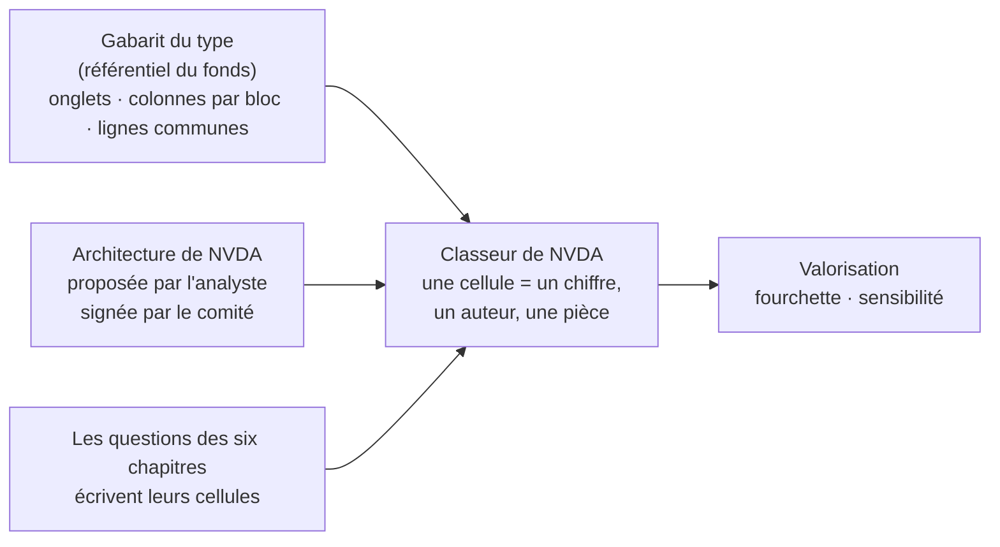
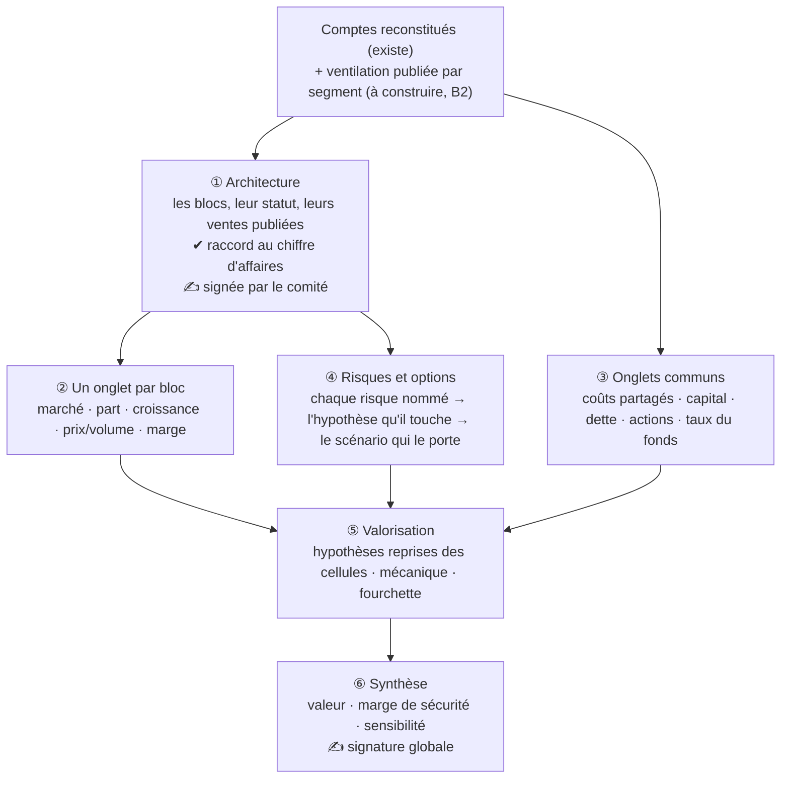

# Le modèle de l'entreprise — spec B1

> Orientation de l'utilisateur (2026-10-19) : « un outil unique, le modèle de l'entreprise, avec autant
> d'onglets que nécessaire pour une modélisation complète ; chaque question de chaque framework y inscrit
> les informations pertinentes ; il sert à la fin à la valorisation ; il se remplit dans le BON ORDRE car
> les questions ultérieures dépendent de décisions de structuration prises en amont ; vérification qualité
> ad hoc à chaque étape ; puis signature globale du tableau, voire analyse de sensibilité ».
> Exigence du 2026-10-21 : l'architecture se réplique sur des entreprises très différentes.

## 0. Ce que ferait un vrai fonds

L'analyste ouvre, pour chaque entreprise, un **classeur bâti sur le gabarit maison du fonds** — le même
squelette pour tous les titres d'un même type. Il le remplit dans un ordre imposé :
1. **l'architecture** : de quels blocs l'entreprise est faite (activités, programmes, métiers), et ce que
   chacun pèse, raccordé aux comptes publiés. Le directeur de la recherche la **valide avant** que
   l'analyste aille plus loin, parce que tout le reste est rangé dessus ;
2. **un onglet par bloc** : son marché, nos ventes, notre part, ce qui le fait croître, ce qu'il rapporte ;
3. **les onglets communs** : coûts partagés, capital, dette, nombre d'actions, taux exigé du fonds ;
4. **l'onglet de valorisation** : hypothèses, scénarios, valeur ;
5. **la synthèse et la sensibilité** : ce que vaut le titre, et ce qui fait bouger cette valeur.

Chaque chapitre de la note d'analyse **renvoie aux cellules** du classeur au lieu de recopier des chiffres ;
le comité signe le classeur entier. Personne ne retape la taille d'un marché dans la note.

## 1. Un gabarit par type d'entreprise, écrit en données

Le système a déjà trois types d'entreprise dans son référentiel : **rentable**, **pré-revenus**,
**financière**. Chacun reçoit **son gabarit de classeur** :

| Type | Le bloc est… | Exemple | Ce qui se chiffre par bloc |
|---|---|---|---|
| Rentable | une activité / un marché | NVDA : centres de données (calcul), centres de données (réseau), jeux, visualisation pro, automobile ; extension annoncée : processeurs centraux | taille du marché, nos ventes, part prise, croissance du marché, prix × volume, part récurrente, marge contributive |
| Pré-revenus | un programme × une indication | RVMD : daraxonrasib pancréas 2ᵉ ligne (approuvé), 1ʳᵉ ligne, poumon ; zoldonrasib… | population traitée, prix, probabilité de succès, date de mise sur le marché, ventes au pic, durée d'exclusivité, coût restant |
| Financière | un métier de bilan | une banque : détail, financement et investissement, gestion d'actifs | encours, marge, commissions, coût du risque, coefficient d'exploitation, fonds propres alloués |

(Chiffres et blocs indicatifs : c'est l'architecture proposée par l'analyste et signée qui fait foi.)

**Ajouter un type d'entreprise = écrire un gabarit**, sans code neuf. Le code ne connaît que des notions
communes : un onglet, un bloc, une cellule, qui l'écrit, qui la lit, quel contrôle la garde.

## 2. Les onglets et l'ordre de remplissage

- **① Architecture** — écrite par la question **me_2** (« d'où vient chaque dollar de chiffre
  d'affaires »), qui EST la question de structure. Chaque bloc a un statut : *métier actuel*, *extension
  annoncée*, *en développement*. Ses ventes constatées viennent de la ventilation publiée (B2), jamais d'une
  estimation. **Rien de l'étape ② ne s'instruit avant que l'architecture soit signée.**
- **② Par bloc** — les questions qui chiffrent un bloc l'écrivent bloc par bloc : me_5 (taille du marché
  par estimation interne, la taille publiée en simple comparaison ; part prise calculée par le code sur les
  ventes constatées seulement — point 9), me_4 (prix et volume), me_2 (part récurrente), me_3 (marge
  contributive), se_2 (partage du marché et sa tendance), mo_6 (pouvoir de prix), mo_4 (durée de la
  barrière), se_4 (position dans le cycle). Pour un pré-revenus : probabilité de succès en jugement ancré
  sur une classe de référence (#97), date et prix.
- **③ Communs** — déjà largement servis par les comptes reconstitués et la qualité financière : qf_1
  (rendement, résultat normalisé), qf_2 (conversion en cash), qf_3 (capital par point de croissance), qf_4
  (dette nette), qf_6 (retraitements), qf_7 (autonomie), ma_1 (part réinvestie), ma_3 (dilution et
  rachats), taux exigé du fonds (10 %, décision du 2026-10-17).
- **④ Risques et options** — les chapitres de jugement (barrière, dépendances, ruptures, gouvernance) ne
  fabriquent pas de chiffres : ils inscrivent **un risque nommé, l'hypothèse qu'il touche, et le scénario
  qui le porte**. Ex. NVDA me_6 « une poignée de clients directs pèse une large part des ventes » (chiffres à relire à la pièce) → touche la croissance du bloc
  centres de données → porté par le scénario bas. Une extension annoncée (processeurs centraux) est une
  **option du scénario haut, jamais le plafond du central** (#137).
- **⑤ Valorisation** — le modèle de valorisation existant (#96-#99) ; ses segments SONT les blocs de
  l'architecture (il peut en regrouper, jamais en inventer) ; ses hypothèses reprennent les cellules.
  va_1-va_6 écrivent leurs résultats (valeur sans croissance, fourchette, classe de référence, croissance
  implicite dans le prix, comparaison aux pairs, marge de sécurité).
- **⑥ Synthèse** — signature globale ; sensibilité : ±1 pt du taux exigé, et les 2-3 hypothèses décisives
  (tableau croisé), recalculées par le code sans appel de modèle.

**L'ordre n'est pas écrit à la main** : chaque question déclare ce qu'elle écrit et ce qu'elle lit ; l'ordre
d'instruction s'en déduit. Une question qui lit une cellule non encore écrite attend ; un circuit (A lit B
qui lit A) est refusé dès l'écriture du référentiel.

## 3. Les contrôles, étape par étape

Le code vérifie la **structure** ; le **sens** se juge à la lecture (Opus, puis le comité) — #68.

| Étape | Contrôle du code | Cas qu'il arrête |
|---|---|---|
| ① | La somme des ventes des blocs actuels retombe sur le chiffre d'affaires publié (écart nommé dans une ligne « autres / éliminations ») ; chaque bloc actuel se rattache à une ligne publiée ; un bloc plus fin que ce qui est publié est un découpage estimé, marqué comme tel | un découpage plausible mais qui ne se raccorde pas aux comptes |
| ② | Chaque cellule a une origine (pièce, reprise, jugement ancré) ; la part prise est calculée, jamais saisie ; aucune part sur des revenus futurs ; unité et période cohérentes | NVDA me_5 #1370 : 200 Md$ d'un marché d'extension, 10 % sur des revenus futurs |
| ③ | La somme des marges contributives moins les coûts communs retombe sur le résultat d'exploitation des comptes (écart nommé) | des marges par bloc incompatibles avec les comptes |
| ④ | Chaque risque vise une hypothèse qui existe, et le scénario qui le porte modifie bien cette hypothèse ; sinon « risque non chiffré », signalé au comité | un risque cité dans la note qui ne bouge aucun chiffre |
| ⑤ | Contrôles existants du modèle de valorisation (pièces au dossier, réponses reprises qui tiennent, la mécanique tourne et lit chaque ligne, fourchette ordonnée) + chaque segment est un bloc signé | un segment inventé par le modèle de valorisation |
| ⑥ | Aucune cellule orpheline (écrite mais lue par personne, ou lue mais jamais écrite) | une ligne signée que le calcul ignore |

## 4. Les signatures

- **L'architecture** : signée au procès-verbal (proposer / signer / écarter, motif), comme le classement du
  titre (#139). Une architecture qui change (nouveau produit, changement de stade, revue annuelle) est une
  nouvelle version : seuls les onglets des blocs ajoutés ou modifiés se rouvrent.
- **Les réponses** : toujours acquittées question par question, comme aujourd'hui.
- **Le classeur entier** : la signature existante du modèle de valorisation (#98) s'étend au classeur ; la
  version signée reste affichée tant qu'une nouvelle n'est pas signée ; l'écart entre versions se lit cellule
  par cellule.

## 5. Ce qui rouvre une cellule

Une cellule suit la réponse qui l'a écrite : si la question est rouverte (fait nouveau, péremption), la
cellule passe « à revoir », et avec elle les hypothèses de valorisation qui la reprennent (#97 : seuls les
chiffres repris bougent seuls ; un jugement modifié donne une nouvelle version proposée). Rien de neuf à
inventer : c'est la tenue du dossier déjà construite (points 13-17), appliquée aux cellules.

## 6. Ce que le comité voit

L'écran E1 est le classeur lui-même : un onglet par étape, chaque cellule avec sa valeur, son origine, sa
pièce, la question qui l'a écrite et son état (tient / à revoir) ; l'onglet synthèse porte la fourchette, la
marge de sécurité au dernier cours coté daté (#81) et la sensibilité. La note d'initiation (E3) cite les
cellules.

## 7. Notes d'implémentation (pour les lots)

- **Référentiel** (`frameworks.yaml`) : clé neuve `gabarits_de_modele` (un par archétype : onglets, colonnes
  par bloc, lignes communes, contrôle de raccord par onglet) ; sur chaque question, `ecrit` / `lit` (adresses
  de cellules `onglet.colonne` ou `onglet.ligne`, avec `par_bloc: true`). Un chiffre clé d'encadré (#100) EST
  une cellule ; les 9 encadrés existants s'y projettent sans changer de sens ; `repris_de` (#99) devient un
  cas de `lit`. Gardes de définition : adresse existante dans le gabarit, un seul auteur par cellule (#99
  généralisé), pas de circuit, unités cohérentes (même famille que le pont [W]).
- **Contrat** : `ModeleEntreprise` (architecture versionnée + cellules), `Architecture` (blocs : id, libellé,
  statut, rattachement à une ligne publiée, ventes constatées) ; `ModeleValorisation` passe à `modele-1.3.0` :
  un segment référence un bloc signé (ou un regroupement nommé de blocs).
- **Ventilation publiée (B2)** : ⚠️ le socle lit `companyfacts` de la SEC, qui ne porte AUCUNE dimension
  (pas de segment). Il faut lire les faits dimensionnés du dépôt lui-même (XBRL du 10-K/10-Q :
  axes « segments d'activité » et « produits et services » ; IFRS 8 pour un 20-F), en extension du socle
  (#115 : le code relève, l'analyste juge). Repli : le tableau de la note sectorielle lu par le collecteur
  (#132). **À mesurer d'abord** (Sonnet, gratuit) : pour NVDA, RVMD et une banque, ce que les dépôts portent.
- **Persistance** : registres append-only (architecture et son PV ; cellules = vue sur les encadrés des
  réponses qui tiennent, recalculée à la lecture, #77 — on ne stocke pas une seconde copie du chiffre).
  Migration 061 et suivantes.
- **Ordre d'instruction** : tri topologique sur `ecrit`/`lit`, utilisé par la chaîne et par la relance
  bornée (#137 point 17) ; porte « architecture signée » avant toute question `par_bloc`.
- **Sensibilité** : rejeux de `evaluer_modele` (déterministe) — ±1 pt sur la cellule du taux, ± l'écart
  justifié sur chaque hypothèse décisive.
- **Contrôle de réplicabilité** : un check greppe le code livré contre les tickers et les noms de blocs ;
  les fixtures des checks portent les trois gabarits (copiés du réel : NVDA, RVMD, une banque).

## 8. Les lots, après validation

| Lot | Contenu | Qui |
|---|---|---|
| M0 | Mesure : ce que les dépôts publient par segment (NVDA, RVMD, une banque) | Sonnet |
| M1 | Gabarits en données + contrat + gardes de définition (adresses, auteur unique, circuits) | Opus spec → Sonnet |
| M2 | Ventilation publiée (B2) au socle | Sonnet sur spec, après M0 |
| M3 | L'architecture : me_2 reformulée, raccord au CA, signature au PV (migration) | Opus spec → Sonnet |
| M4 | Encadrés par bloc et communs (me_3-5, se_2, se_4, mo_4, mo_6, ma_1, ma_3) ; onglet risques (④) | Opus (énoncés, avec vous) → Sonnet |
| M5 | Ordre d'instruction dérivé ; la chaîne le suit | Sonnet sur spec |
| M6 | L'agent de valorisation (B3) sur le classeur ; va_4-6 au cours du jour (B4) ; Greenwald (B5) | Opus → Sonnet |
| M7 | Sensibilité, signature globale, alerte d'échéance du taux (B7) | Sonnet |
| M8 | Acceptation sur NVDA ET RVMD (B8) | Sonnet lance, Opus lit |

**Conséquence pour les relances NVDA (D1)** : les questions qui n'écrivent rien par bloc (défendabilité
mo_1-3/mo_5, management, se_5, se_6) peuvent être relancées dès C1 ; me_6, se_2 et la suite du modèle
économique attendent l'architecture signée.

## 9. Ce qui ne change pas

Le socle des comptes, les encadrés existants (projetés en cellules), le bac à calcul, les 13 calculs fermés,
les contrôles du modèle de valorisation, la tenue du dossier (fraîcheur, relance, baisse signalée), le taux
exigé du fonds.

## 10. Arbitrages à rendre (soumis le 2026-10-21)

1. **Deux signatures ou une ?** Le comité signe-t-il l'architecture AVANT que les onglets par bloc soient
   instruits, puis le classeur à la fin (recommandé : c'est ce que fait un directeur de la recherche ; sinon
   une vingtaine de réponses s'instruisent sur un découpage que le comité peut refuser) — ou une seule
   signature finale (plus rapide, risque de tout refaire) ?
2. **Qui écrit l'architecture ?** La question me_2 du chapitre modèle économique, qui la pose déjà
   (recommandé) — ou une étape dédiée avant tous les chapitres ?
3. **Les chapitres de jugement dans le classeur ?** Barrière, dépendances, ruptures, gouvernance inscrivent
   leurs risques dans un onglet « risques et options » relié aux scénarios (recommandé : un risque cité qui
   ne bouge aucun chiffre est signalé) — ou restent hors du classeur, lus seulement par le comité ?
4. **Plus fin que ce qui est publié ?** NVIDIA publie ses ventes par grand marché (centres de données, jeux…)
   et commente calcul et réseau, pas « accélérateurs pour l'IA » contre « autres » (maille exacte : mesure M0). Un bloc plus fin que la publication est-il admis, s'il se
   raccorde à la ligne publiée qui le contient et qu'il est marqué « découpage estimé » (recommandé : c'est la
   pratique des analystes) — ou l'architecture s'arrête-t-elle à la maille publiée ?
