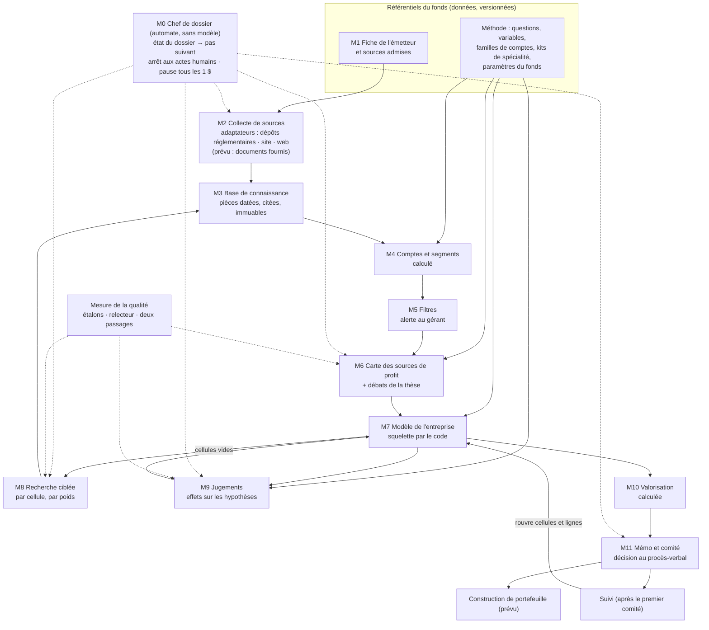

# Architecture cible — le schéma des blocs

> **Réécrit le 2026-11-13** après les arbitrages de l'évaluation d'architecture
> (`EVALUATION-ARCHITECTURE-2026-11-13.md`). Règles durables : `principe-directeur.md` (la constitution).
> Ordre et acceptation des modules : `07-avant-comite.md`.
>
> **L'architecture RÉALISÉE n'est pas décrite en prose** : elle est prouvée par la suite
> `backend/checks/` (`bash checks/run_all.sh` ; dernier total : `backend/checks/LIGNE_DE_BASE.md`, écrit
> par le lanceur — seule source du chiffre). Chaque module a son `ARCHITECTURE.md` qui mappe
> *invariant → assert garant*. Cette organisation est elle-même gardée par `check_architecture.py`
> (+ `negatif_architecture.sh`) : ajouter un module = sa ligne dans un des deux registres ci-dessous
> **et** son `ARCHITECTURE.md`.

## Les blocs

| # | Bloc | Reçoit | Rend (contrat de sortie) | Tenu au fonds par |
|---|---|---|---|---|
| M0 | Chef de dossier | L'état du dossier, les pas déclarés | Pas suivant, ou acte humain attendu, nommé ; dépense comptée | Analyste responsable |
| M1 | Fiche de l'émetteur et sources | Vos corrections | Fiche (identité maison, références externes facultatives, où la société publie, spécialité) ; registre des sources admises, daté et motivé | Direction de la recherche |
| M2 | Collecte de sources | Une demande (quoi, pour qui, depuis quand) | Documents bruts avec leur origine, ou « source indisponible » nommée | Documentation |
| M3 | Base de connaissance | Documents | Pièces datées, à extraits vérifiés, jamais modifiées | Documentation |
| M4 | Comptes et segments | Pièces comptables | Comptes reconstitués, ratios maison, ventilation, périmètre — par famille de comptes | Personne : calculé |
| M5 | Filtres | Comptes, quelques pièces | Alertes motivées ; continuer ou arrêter reste au gérant | Gérant |
| M6 | Carte des sources de profit | Collecte dédiée | Inventaire élément × marché, classé, contrôlé ; débats de la thèse proposés | Directeur de la recherche (valide) |
| M7 | Modèle de l'entreprise | Carte, segments, catalogue | Classeur : lignes, moteurs, cellules avec origine ; cellules vides | Modélisateur |
| M8 | Recherche ciblée | Une cellule vide, son poids | Valeur, fourchette, pièce ou méthode | Analyste |
| M9 | Jugements | Classeur rempli, pièces | Pour chaque jugement : l'hypothèse déplacée, le sens, la pièce | Analyste |
| M10 | Valorisation | Classeur, cours daté | Valeur centrale, fourchette, ce que le prix suppose, marge de sécurité | Personne : calculé |
| M11 | Mémo et comité | Classeur, jugements, valorisation | **Décision du comité** au procès-verbal | Comité |
| — | Mesure de la qualité (à partir de M6) | Sorties de M6, M8, M9 ; étalons | Taux d'erreur par bloc ; écart entre deux passages | Directeur de la recherche |

Deux règles tiennent le schéma (constitution §3) : **un bloc ne lit d'un autre que son contrat de
sortie** ; **le non coté et l'UE n'ajoutent que des adaptateurs, un kit de spécialité et une famille de
comptes**.

## Registre 1 — modules reconstruits (`backend/app/modules/`)

| Module | Rôle | Contrôle | `ARCHITECTURE.md` |
|---|---|---|---|
| (charte) | Registre des modules et garde des accès entre eux | `check_charte_modules.py` | `app/modules/ARCHITECTURE.md` |
| `chef_de_dossier` (M0) | État du dossier → pas suivant | `check_chef_de_dossier.py` | `app/modules/chef_de_dossier/ARCHITECTURE.md` |

## Registre 2 — ancien code (la carrière)

Reste en place et vert tant que le module qui le remplace n'est pas accepté ; trié à l'ouverture de ce
module (repris tel quel / repris derrière le contrat / laissé), supprimé à son acceptation.

| Paquet | Ce que c'est | Trié à l'ouverture de | `ARCHITECTURE.md` |
|---|---|---|---|
| `app/knowledge/` | Base de connaissance, producteurs déterministes, recherche, registre des sources | M1 (sources), M2, M3, M4 | `app/knowledge/ARCHITECTURE.md` |
| `app/frameworks/` | Référentiel des questions (`frameworks.yaml`) | M6, M9 | `app/frameworks/ARCHITECTURE.md` |
| `app/agents/v2/` | L'ancien flux : traducteur, collecteur, analyste, manager, comité | M2, M8, M9, M11 | `app/agents/v2/ARCHITECTURE.md` |
| `app/contracts/` | Contrats des sorties d'agents | au fil des modules | `app/contracts/ARCHITECTURE.md` |
| `app/api/` | Surface backend → frontend | au fil des écrans | `app/api/ARCHITECTURE.md` |
| `app/valorisation/` | Atelier de valorisation, bac à calcul | M10 | `app/valorisation/ARCHITECTURE.md` |
| `app/modele_entreprise/` | Ancien classeur : catalogue, inventaire, architecte | M6, M7 | `app/modele_entreprise/ARCHITECTURE.md` |
| `app/data_collection/` | Service de marché V0/V1 | M10 (cours daté) | `app/data_collection/ARCHITECTURE.md` |
| `app/nasdaq/` | **Sous-projet indépendant, hors chantier** (reprise : `backend/app/nasdaq/00-REPRISE-NASDAQ.md`) | — | `app/nasdaq/ARCHITECTURE.md` |
