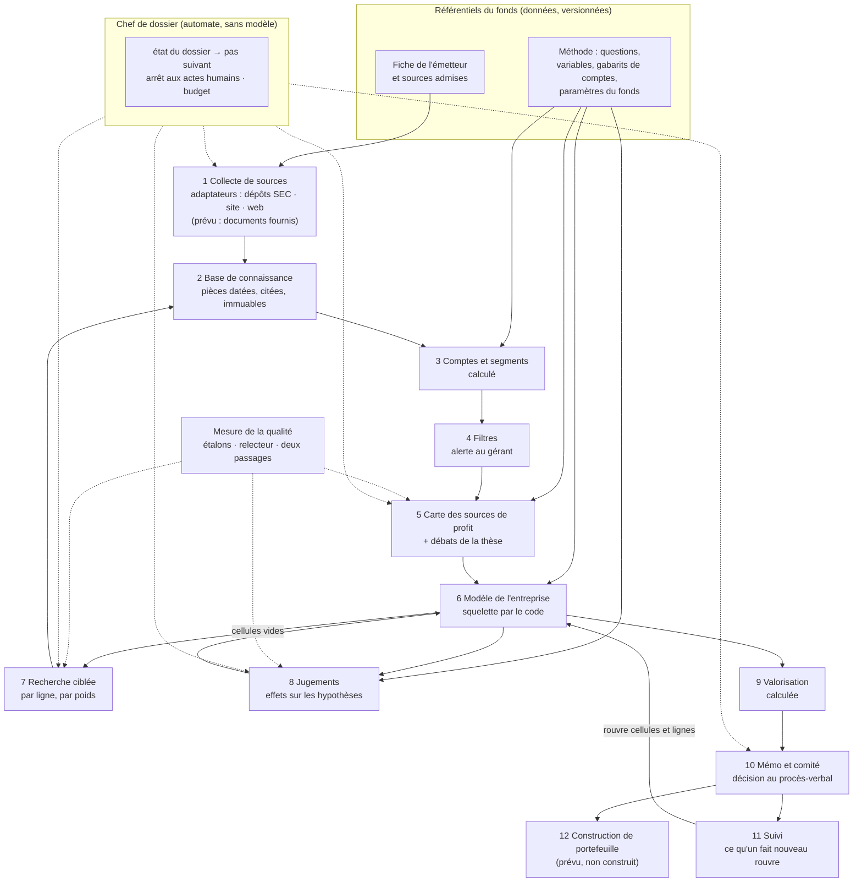

# Évaluation de l'architecture — audit et propositions

2026-11-13

## Verdict

**Adapter la proposition du 24/10 : son ordre est le bon (le modèle de l'entreprise devient la colonne
vertébrale, la collecte part de lui), mais elle ne traite pas les trois écarts les plus graves aux
exigences — personne ne conduit un dossier d'un bout à l'autre sans vous, le SENS d'une analyse n'est ni
mesuré ni rejoué, et « société américaine déposant à la SEC » est écrit dans le cœur.**

Je recommande donc de l'adopter avec cinq amendements, dans cet ordre :

1. un **chef de dossier** automatique (le système enchaîne seul jusqu'à « prêt pour le comité ») ;
2. une **mesure du sens** (dossiers étalons relus une fois, relecteur indépendant, deux passages comparés) ;
3. des **contrats entre blocs**, gardés par un contrôle, avant de déplacer quoi que ce soit ;
4. un **point d'extension « émetteur et sources »** (ce qui est propre à un titre devient une donnée) ;
5. le **gel** de ce qui a été construit en avance sur le besoin.

Aucun point de la liste « Ce qui est fermé » n'est rouvert.

## Ce que j'ai lu et vérifié, et ce que je n'ai pas pu vérifier

| Source | État |
|---|---|
| Principes fondateurs, reprise, proposition du 24/10, constitution, spec 03 §0, architecture cible, spec du modèle (09), plan 07 et son journal, les 9 `ARCHITECTURE.md` de module | Lus |
| Doctrine des trois axes, `CONVENTIONS.md` | Index et grep ciblé seulement (doctrine fermée, non critiquée) |
| Code | Mesuré par commande : tailles, graphe d'imports, constantes, routes, tâches planifiées |
| Suite de contrôles | **Rejouée ici, hors ligne, sans Docker ni base** : 62 scripts verts, **5 833 vérifications, 0 échec** |
| 14 contrôles qui lisent la base | **Non vérifiés** : ils sortent en échec faute de base, comme prévu (aucun ne s'est « sauté ») |
| Tests négatifs (`negatif_*.sh`) | **Non vérifiés** : le harnais exige Docker |
| État réel des dossiers NVDA / RVMD | **Non vérifié** : pas d'accès à la base ; les chiffres cités sont ceux de la reprise et du journal (16-24/10) |

Réserve sur le rejeu : il a tourné sous Python 3.13 et une version de pydantic plus récente que l'image
de production. Un vert ici ne remplace pas `bash checks/run_all.sh` sur le VPS (dernier total consigné :
6 115 avec la base).

## Les constats, par gravité

**P** = prouvé (commande ou fichier) · **D** = déduit · **N** = non vérifié.

| # | Gravité | Constat | Preuve | |
|---|---|---|---|---|
| 1 | Critique | **Personne ne conduit le dossier.** Aucune tâche planifiée ni aucune route ne lance l'instruction d'un titre : elle n'avance que par des outils en ligne de commande (`executer_chaine.sh`, `architecte.sh`, `boucler_renvois.sh`…) lancés par une séance de développement. Le « pas suivant » d'un dossier vit dans le plan 07, pas dans le système. | `main.py` : 11 tâches planifiées, dont une seule V3 (notes flash, en recensement, `v2_auto_enabled = FALSE`) ; aucune route `api/` n'appelle la chaîne | P |
| 2 | Critique | **Le sens n'est ni mesuré ni rejoué.** Les ~5 800 vérifications gardent la structure. Le sens se juge « à la lecture » par le développeur ou par vous. Quatre architectures passaient les contrôles et aucune n'était signable ; la réponse `me_7` de NVDA était « au vert » et mêlait une génération, un produit, des clients et une acquisition ; à dossier identique, trois relevés donnent 4, 4, 3 éléments (NVDA) et 4, 7, 7 (RVMD). Aucun taux d'erreur par étape n'existe ; la comparaison de deux passages (05 A10-A11) n'est pas construite. | Journal 07 (22/10, 24/10) ; reprise « le verdict est à la lecture » ; 05 A10, A11 non cochés | P |
| 3 | Majeur | **Le modèle arrive en dernier, sur les restes des chapitres.** Quatre jours et une vingtaine de passages sur le seul découpage ; le diagnostic du 23/10 attribue trois défauts sur quatre à l'INFORMATION remise à l'architecte, pas à sa capacité. C'est la cause que la proposition corrige. | Journal 07, ligne « B4d (diagnostic) » | P |
| 4 | Majeur | **« Cotée aux États-Unis, déposant à la SEC » est dans le cœur.** L'identité d'un émetteur EST son numéro SEC ; le flux lui-même (pas seulement la collecte) connaît les formulaires ; les axes de ventilation exigent le plan comptable américain. | `edgar_feed.IdentiteEmetteur(symbole, cik, raison_sociale)` ; formulaires et EDGAR cités 61 fois dans `collecte_executor`, 37 dans `note_flash`, 8 dans `comite`, 4 dans `classement` ; `ventilation_schema` exige `us-gaap:`/`srt:` | P |
| 5 | Majeur | **Ajouter un titre, c'est modifier le code.** Le site de l'émetteur et son secteur (dont dépendent ses sources admises) sont des tables écrites dans le code, pour trois titres. L'acte « admettre une source » — que les principes réservent à l'humain — n'a ni écran ni procès-verbal : c'est un commit. | `websearch._ISSUER_DOMAINS` (NVDA, MSFT, RVMD) ; `source_registry._TICKER_SECTEURS` (RVMD) et `_ADMISES` | P |
| 6 | Majeur | **Les blocs ne sont pas séparés par des contrats.** Deux paquets portent l'essentiel (flux : 16 300 lignes ; base de connaissance : 12 900) et s'importent l'un l'autre. Les contrats versionnés décrivent les sorties des agents, pas les échanges entre blocs. | Imports à rebours : `knowledge → agents.v2` ×6 (`explorateur`, `lecture_depot`, `source_registry`, `synthesis_feed`, `ventilation_feed`), `knowledge → modele_entreprise`, `valorisation → agents.v2.parcours` ×3, `contracts → knowledge`, `agents.v2 → api` | P |
| 7 | Majeur | **Un seul fournisseur de modèles, et le résultat dépend du modèle.** Agents et recherche par similarité passent tous par DeepInfra ; la fabrique ne connaît que DeepInfra et Dust (la constitution annonce une abstraction générale). Deux modèles sont épinglés dans le code, contre la règle « une valeur en base ». Or le journal montre qu'un changement de modèle change le sens (Vera Rubin : un modèle réussit 2/2, l'autre jamais) — et aucun contrôle ne le verrait. | `providers/__init__.py` ; `architecte.MODELE_ARCHITECTE`, `inventaire.MODELE_INVENTAIRE` ; journal 23/10 | P |
| 8 | Majeur | **Après le comité, tout lit encore l'ancien système.** La page de décision et la taille de position lisent la thèse V2 ; il n'existe pas d'objet « décision du comité » V3 sur lequel brancher un module de portefeuille. | Plan 07 E2 ; `decision.py` (taille lue dans la synthèse V2, cours par l'ancien service de marché) | P |
| 9 | Moyen | **Construit en avance sur le besoin.** Aucun dossier n'est allé au comité, aucune valorisation n'existe ; pourtant existent : registres de fourchettes et scénarios (vides, calcul non branché), explorateur du dossier (éteint), mécanique de valorisation écrite par un agent jamais construit, 19 contrôles pour un architecte que la proposition relègue en secours, 9 interrupteurs, 143 conventions. | `modele_entreprise/ARCHITECTURE.md` (« rien ne l'appelle encore ») ; `valorisation/ARCHITECTURE.md` (« pas encore construit ») | P |
| 10 | Moyen | **Manquent, pour un fonds long terme concentré :** l'entrée d'un titre dans le pipeline (sourcing), le filtre « on n'ira pas plus loin », la thèse et ses débats, l'écran du modèle, le suivi d'une position après décision, les règles de vente. Le module NASDAQ est un embryon de sourcing, relié à rien. | Plan 07 (E1-E3 à faire, « Après le premier comité ») ; `nasdaq/ARCHITECTURE.md` | P |
| 11 | Moyen | **Non éprouvé hors NVDA et RVMD.** MSFT n'a aucune réponse en vigueur ; le banc de dix entreprises n'est pas commencé ; une banque ne peut pas entrer (comptes trompeurs au gabarit industriel) ; Apple et Microsoft publient deux découpages superposés que le relevé ne sépare pas. Un chapitre prend environ une heure, en série. | Reprise ; plan 07 « Dettes hors du chemin » | P (docs), N (état réel) |
| 12 | Moyen | **Verts à lire avec prudence.** 26 contrôles n'ont pas de test négatif à leur nom (dont l'acte de décision, le suivi, le registre des sources) : selon la règle du projet, ces briques « n'existent pas ». Un test négatif connu à 43/44. L'interrupteur qui laisse une réponse refusée ouvrir la porte de l'architecte est en position « test ». Trois documents citent trois lignes de base différentes (2 172, 2 388, 6 082). | Comptage `checks/` ; `modele_entreprise.yaml` l. 42 ; `ARCHITECTURE-CIBLE.md`, `METHODE-TEST.md`, reprise | P (comptage), N (négatifs) |
| 13 | Mineur | **La constitution décrit un autre système.** Elle s'intitule « Architecture V2 », nomme des modèles qui ne sont pas utilisés et dit « préservé » un mécanisme que la reprise dit supprimé (la grille MVDD). Le schéma d'`ARCHITECTURE-CIBLE.md` ne montre ni le modèle, ni la valorisation, ni le comité. | `principe-directeur.md` §3-§4 ; reprise « Ce qui est fermé » | P |
| 14 | Mineur | **Écart entre le dépôt et la production.** Cinq lots sont commités sans être déployés ; deux migrations NASDAQ restent à appliquer à la main. | Reprise | N |

### Ce que le module NASDAQ enseigne

Il tient en 773 lignes, n'importe que l'accès à la base, possède ses tables (préfixées), ses migrations,
son écran et son contrôle ; il a été livré en cinq jours pendant que le découpage de NVDA en prenait
quatre sans aboutir. Trois leçons transposables : **un bloc possède ses tables et personne d'autre ne les
lit** ; **un bloc se livre avec son écran** (on voit ce qu'il produit) ; **un bloc se teste seul**. Une
limite : il n'a aucun consommateur. Son autonomie est celle d'une feuille, pas d'un maillon — les blocs
du cœur ont, eux, besoin d'un contrat de sortie, ce que NASDAQ n'a pas eu à écrire.

### Les interventions humaines aujourd'hui

*Ce que ferait un vrai fonds* : le gérant décide, le directeur de la recherche valide une méthode et
relit par sondage, le contrôle des risques admet une source de prix ; personne ne relance un analyste
à la main ni ne signe quarante paragraphes.

| Intervention | Verdict | Condition de sortie |
|---|---|---|
| Lancer chaque étape, relancer, enchaîner (terminal) | **À supprimer** | Chef de dossier (proposition 2) |
| Lire chaque réponse contre ses pièces pour en juger le sens | **À automatiser**, sondage humain conservé | Relecteur indépendant + taux d'erreur mesuré sur étalons (proposition 3) |
| Acquitter chaque réponse, une à une (≈ 40 par titre) | **À automatiser** : le comité ne voit que les exceptions | Taux de faux acquittements mesuré, sous un seuil que vous fixez |
| Valider la carte des sources de profit (aujourd'hui : signer l'architecture) | **Légitime pour l'instant**, débrayable | Trois cartes de suite signées sans retouche, sur trois formes d'entreprise |
| Déclarer le site d'un émetteur, son secteur | **À automatiser** (le système propose, vous confirmez une fois) | Proposition 4 |
| Admettre une nouvelle source de référence | **Légitime** — mais doit devenir un acte au procès-verbal, pas un commit | Proposition 4 |
| Reclassement comptable propre à un émetteur | **Légitime** (interprétation) ; le système propose | — |
| Classer le titre, le reclasser à un changement de stade | **Légitime** (déjà : le système recommande) | — |
| Trancher une interprétation contestée (renvoyer, rétablir, remettre à zéro) | **Légitime** | — |
| Signer le modèle et sa fourchette | **Légitime** | — |
| Décider d'investir | **Légitime, irréductible** | — |
| Fixer le plafond de dépense | **Légitime**, une fois par période plutôt qu'à chaque mesure | Budget par dossier (proposition 2) |
| Déployer, appliquer une migration | **À supprimer** du chemin d'un dossier (c'est du développement, pas de l'instruction) | — |

### Coût et robustesse

- **La dépense de modèle n'est pas la contrainte** : 3,21 $ consommés en octobre ; un passage de
  l'architecte coûte de 0,01 à 0,9 $. **Le coût réel est le temps de relecture humaine et la durée**
  (≈ 1 h par chapitre, en série). Le coût complet d'un dossier n'est **pas mesuré** (les recherches web
  ne sont pas comptées).
- **Les instabilités observées ont trois causes**, toutes de principe 4 : (a) une tâche qui mêle relever
  et juger (résolu en séparant inventaire, classement, construction) ; (b) une information absente de
  ce que le modèle reçoit (résolu par la collecte dédiée de la proposition) ; (c) le hasard d'un passage
  unique sur une liste ouverte (se traite par plusieurs lectures réunies et vérifiées, déjà esquissé le
  24/10). Aucune n'est propre à NVDA.

## Les propositions, dans l'ordre recommandé

### 1. Adopter l'ordre de la proposition, avec deux retouches

- **Problème et cause** : constat 3. Les chapitres collectent avant de savoir ce que le modèle demandera.
- **Ce que ferait un vrai fonds** : quelques jours de lecture, un premier modèle, puis la recherche ligne
  par ligne — et, dès le premier modèle, trois ou quatre débats écrits qui dirigent l'effort.
- **Recommandé** : les huit étapes de la proposition, plus (a) la carte se termine par les débats de la
  thèse ; (b) l'effort suit à la fois le poids dans la valeur et les débats. *Alternative* : garder
  l'ordre actuel et finir le découpage — écartée, la cause resterait.
- **Coût, risque** : surtout du réordonnancement ; risque = un squelette par le code trop rigide pour une
  holding ou une banque (l'architecte-modèle reste en secours).
- **Acceptation, écrite avant** : celle de la proposition (chaque élément listé par l'émetteur est dans la
  carte, à chaque passage ; le total des lignes de la première année égale le chiffre d'affaires publié).
- **Plan 07** : les sorts du tableau de la proposition, inchangés.
- **Réversible** : l'architecte-modèle redevient le chemin principal par un interrupteur.

### 2. Un chef de dossier

- **Problème et cause** : constat 1. Les portes existent une à une (porte de l'architecte, alerte « peut-on
  décider ? »), mais rien ne les enchaîne.
- **Ce que ferait un vrai fonds** : un analyste tient son dossier ; il ne s'arrête que lorsqu'il lui faut
  une décision d'un supérieur, et il dit laquelle.
- **Recommandé** : un automate SANS modèle de langage qui lit l'état du dossier, lance le pas suivant,
  s'arrête à un acte humain en le nommant, et respecte un budget par dossier. *Alternatives* : garder les
  outils en ligne de commande (statu quo) ; confier l'enchaînement à un agent (rejeté : non rejouable).
- **Coût, risque** : moyen ; le risque est une dépense qui s'emballe — d'où le budget et l'arrêt au
  premier refus répété.
- **Acceptation** : sur une société FICTIVE et des modèles simulés (zéro dépense), le dossier va de
  « titre entré » à « prêt pour le comité » sans commande manuelle, en s'arrêtant exactement aux actes
  humains déclarés ; couper le budget l'arrête et le dit.
- **Plan 07** : s'insère avant D1 (les relances NVDA en deviennent le premier usage réel).
- **Réversible** : éteint, on retrouve les outils actuels.

### 3. Mesurer le sens

- **Problème et cause** : constat 2. Un contrôle de structure ne peut pas juger le sens (convention 68) ;
  rien d'autre ne le fait.
- **Ce que ferait un vrai fonds** : le directeur de la recherche relit quelques notes en entier, garde
  celles qui font référence, et y compare le travail d'un nouvel analyste.
- **Recommandé** : (a) des **dossiers étalons** — pour NVDA et RVMD, la carte et une douzaine de réponses
  relues une fois par vous, figées ; (b) un **relecteur indépendant** (autre modèle, ne voit que la
  réponse et ses pièces, dit « fondé / non fondé / contredit » avec l'extrait) ; (c) **deux passages
  comparés** sur le même dossier. Chaque étape reçoit un taux d'erreur. *Alternative* : continuer la
  lecture par le développeur — c'est le goulot actuel.
- **Coût, risque** : l'outil est gratuit ; les mesures sont payantes (phase 3, plafond à fixer) ; votre
  temps : une relecture initiale. Risque : un relecteur complaisant — se mesure sur les étalons, où la
  bonne réponse est connue.
- **Acceptation** : sur les étalons, le relecteur retrouve les erreurs déjà consignées au journal (me_7
  de NVDA, la part de marché sur revenus futurs) et n'en signale pas sur les réponses jugées justes.
- **Plan 07** : avance A10-A11 (aujourd'hui « après le comité ») ; remplace D2.
- **Réversible** : le relecteur signale, il ne bloque pas, tant que vous ne le décidez pas.

### 4. Un point d'extension « émetteur et sources »

- **Problème et cause** : constats 4 et 5. L'identité et les sources d'un titre ont été écrites là où on en
  avait besoin la première fois.
- **Ce que ferait un vrai fonds** : une fiche par société (qui elle est, où elle publie, quelles sources
  on tient pour fiables sur elle), tenue par la recherche, modifiée par un acte daté.
- **Recommandé** : une **fiche de l'émetteur** en donnée (identité maison ; références externes
  facultatives, dont le numéro SEC ; site ; secteur) et un **registre d'admission des sources** avec
  procès-verbal ; la collecte passe par des **adaptateurs** (dépôts réglementaires : la SEC est le
  premier ; documents fournis : prévu, non construit). Le cœur ne nomme plus un formulaire : il demande
  « les derniers comptes annuels », l'adaptateur répond. *Alternative* : ne rien toucher avant le premier
  titre non américain — c'est ce qui a rendu le problème invisible jusqu'ici.
- **Coût, risque** : moyen, à faire par tranches ; ne construit ni le non coté ni une autre juridiction.
- **Acceptation** : une société fictive SANS numéro SEC traverse le cœur sans plantage, chaque étape
  répondant « source indisponible » nommée ; ajouter un titre réel ne modifie aucun fichier de code.
- **Plan 07** : hors du chemin de NVDA ; à faire avant MSFT et la financière.
- **Réversible** : la fiche est remplie à l'identique de ce que le code dit aujourd'hui.

### 5. Des contrats entre blocs, gardés

- **Problème et cause** : constat 6. Rien n'interdit à un bloc de lire l'intérieur d'un autre.
- **Recommandé** : pour chaque bloc, UN objet de sortie versionné et une seule fonction de lecture ; le
  contrôle d'architecture existant refuse tout import hors de la liste déclarée. Commencer par trois
  objets pivots : la fiche de l'émetteur, l'état du dossier, le classeur. *Alternative* : un grand
  redécoupage des paquets — coûteux, sans gain immédiat.
- **Coût, risque** : faible, gratuit ; révèle les dix imports à rebours, à défaire un par un.
- **Acceptation** : le contrôle rougit quand la base de connaissance importe le flux (test négatif).
- **Plan 07** : en parallèle, sans effet sur l'ordre.

### 6. Geler ce qui est en avance

Explorateur du dossier, fourchettes et scénarios, mécanique de valorisation écrite par un agent, nouveaux
contrôles de l'architecte-modèle : **rien n'est supprimé, rien n'y est ajouté** avant le premier comité.
Acceptation : aucun commit sur ces fichiers d'ici là, hors correction d'un rouge.

### 7. Les modèles : un choix par rôle, qualifié

- **Recommandé** : le modèle de chaque rôle devient une donnée (les deux constantes sortent du code) ;
  changer de modèle exige de rejouer les étalons de la proposition 3 ; un second fournisseur est déclaré,
  même inutilisé. *Ce que ferait un fonds* : on ne change pas de fournisseur de données sans une période
  de double lecture.
- **Acceptation** : changer le modèle d'un rôle sans rejeu des étalons est refusé et le dit.

### 8. La sortie du comité devient un contrat

- **Problème** : constat 8. Sans objet « décision », ni le portefeuille ni le suivi ne peuvent se brancher.
- **Recommandé** : la tâche E2 produit une **décision du comité** — titre, décision, fourchette signée,
  marge de sécurité au cours daté, conviction, conditions, indicateurs de suivi, date de revue. Le module
  de **construction de portefeuille** (taille, concentration, règles de vente) lira cet objet et lui seul ;
  on ne le construit pas.
- **Acceptation** : la décision NVDA se lit sans ouvrir aucune table de l'ancien système.

### 9. Remettre les documents de cadre à jour

Constitution renommée et purgée de ce qui ne s'applique plus ; `ARCHITECTURE-CIBLE.md` remplacé par le
schéma des blocs ci-dessous ; une seule ligne de base de la suite, écrite par le lanceur.

## Réponses aux six questions de la proposition

| Question | Recommandation | Pourquoi |
|---|---|---|
| Le directeur de la recherche valide-t-il la carte avant la recherche par ligne ? | **Oui, débrayable.** | C'est le moment où une erreur coûte le moins ; on l'éteint après trois cartes de suite signées sans retouche sur des entreprises de formes différentes. |
| Les filtres éliminatoires passent-ils en tête ? | **Oui, comme alerte, jamais comme arrêt automatique.** | Arrêter un dossier est une décision de gérant. On n'y met que ce qui se lit dans les comptes et une ou deux pièces (dette, autonomie, clauses des prêteurs, qui décide). J'y ajouterais « hors de notre compétence », qu'un fonds concentré utilise plus que tout autre filtre. |
| Une ligne mineure se projette-t-elle sur sa tendance, sans recherche ? | **Oui — mais pas de seuil neuf.** | Réutiliser le seuil de matérialité déjà décidé (10 % de la valeur) : on laisse sur leur tendance les plus petites lignes tant que leur SOMME reste sous ce seuil, et jamais une ligne qui porte un débat de la thèse. Au premier passage, avant toute valeur, le poids se lit dans le chiffre d'affaires publié. |
| Le mémo s'organise-t-il autour de la thèse et des débats ? | **Oui.** | Un comité décide sur ce que le marché sous-estime ; les six chapitres deviennent des annexes consultables, sans perdre aucune pièce. |
| La mécanique de valorisation découle-t-elle du squelette ? | **Oui ; un agent pour les seuls comparables.** | Un calcul écrit par un modèle varie d'un passage à l'autre (arbitrage du 28/09). Le bac à calcul reste en secours pour une forme hors moule. |
| Les chapitres déjà instruits sur NVDA servent-ils de pièces à la carte ? | **Non pour la construire ; oui pour la contrôler.** | La carte repart de sa seule collecte dédiée (on mesure ce qu'elle trouve seule), puis on la compare gratuitement à ce que les chapitres avaient relevé : tout élément connu des chapitres et absent de la carte est un défaut d'exhaustivité nommé. |

## L'architecture cible, en blocs

| Bloc | Reçoit | Rend (contrat de sortie) | Propriétaire au fonds | Dépend de |
|---|---|---|---|---|
| Référentiels | Vos décisions | Fiche de l'émetteur ; registre des sources admises ; méthode (questions, variables, gabarits, paramètres) | Direction de la recherche, vous | — |
| 1 Collecte de sources | Une demande (quoi, pour qui, depuis quand) | Des documents bruts avec leur origine, ou « source indisponible » nommée | Documentation | Fiche de l'émetteur |
| 2 Base de connaissance | Documents | Pièces datées, à extraits vérifiés, jamais modifiées | Documentation | 1 |
| 3 Comptes et segments | Pièces comptables | Comptes reconstitués, ratios, ventilation, périmètre — par famille de comptes | Personne : calculé | 2, gabarits |
| 4 Filtres | Comptes, quelques pièces | Alertes motivées ; « continuer / arrêter » reste au gérant | Gérant | 3 |
| 5 Carte des sources de profit | Collecte dédiée | Inventaire élément × marché, classé, contrôlé contre les listes de l'émetteur ; débats de la thèse | Directeur de la recherche (valide) | 2, 3 |
| 6 Modèle de l'entreprise | Carte, segments, catalogue | Classeur : lignes, moteurs, cellules avec origine et pièce ; liste des cellules vides | Analyste ; personne pour le squelette | 3, 5 |
| 7 Recherche ciblée | Une cellule vide, son poids | Une valeur, sa fourchette, sa pièce ou sa méthode | Analyste | 1, 2, 6 |
| 8 Jugements | Classeur rempli, pièces | Pour chaque jugement : l'hypothèse qu'il déplace, le sens, la pièce | Analyste, relu par le comité | 2, 6 |
| 9 Valorisation | Classeur, scénarios, cours daté | Valeur centrale, fourchette, ce que le prix suppose, marge de sécurité | Personne : calculé | 6 |
| 10 Mémo et comité | Classeur, jugements, valorisation | **Décision du comité** au procès-verbal | Comité | 6, 8, 9 |
| 11 Suivi | Dépôts et faits nouveaux, décision | Cellules et lignes rouvertes ; alerte de revue | Analyste | 1, 6, 10 |
| 12 Construction de portefeuille *(prévu)* | Décisions du comité, portefeuille | Taille, concentration, règles de vente | Gérant, contrôle des risques | 10 seulement |
| Non coté *(prévu)* | — | Un adaptateur de plus au bloc 1, une famille de comptes de plus au bloc 3 | — | Référentiels |
| Chef de dossier | État du dossier | Pas suivant, ou acte humain attendu, nommé | Analyste responsable | lit tous les contrats, n'en écrit aucun |
| Mesure de la qualité | Sorties de 5, 7, 8 ; étalons | Taux d'erreur par bloc ; écart entre deux passages | Directeur de la recherche | étalons |

Deux règles tiennent le schéma : **un bloc ne lit d'un autre que son contrat de sortie**, et **le non
coté n'ajoute que des adaptateurs et une famille de comptes** — s'il fallait toucher un autre bloc pour
l'accueillir, le contrat de ce bloc serait à revoir maintenant.

## Ordre proposé jusqu'au premier comité de NVDA

1. Contrats entre blocs et leur contrôle (proposition 5) ; gel (6) — gratuits.
2. Carte de NVDA et de RVMD (étape 1 de la proposition du 24/10), sur étalons relus (début de 3).
3. Chef de dossier, éprouvé sur une société fictive (2).
4. Squelette par le code, recherche par ligne, jugements, valorisation, mémo (étapes 2 à 6 de la
   proposition), conduits par le chef de dossier.
5. Décision du comité comme contrat (8) ; séance.

Hors du chemin de NVDA, avant le titre suivant : fiche de l'émetteur et adaptateurs (4), modèles par
rôle (7), documents de cadre (9).

## Questions pour vous

1. **Qui tient le dossier entre deux séances ?** NVDA est arrêté depuis le 24 octobre parce que personne
   n'a relancé l'étape suivante. Acceptez-vous que le système avance seul jusqu'à « prêt pour le
   comité », sous un plafond de dépense par dossier que vous fixez une fois, en ne s'arrêtant que pour
   une décision qui vous revient ?
2. **Signez-vous chaque réponse, ou seulement les exceptions ?** Pour NVDA, une quarantaine de réponses
   attendent un acquittement. Un comité de fonds ne signe pas chaque paragraphe : il voit ce qui a été
   renvoyé, ce qui s'est dégradé (la réponse sur l'emploi du capital de NVDA, moins fondée que la
   précédente) et ce que le relecteur conteste. Laquelle des deux pratiques voulez-vous ?
3. **Acceptez-vous un second lecteur ?** La réponse « ce que NVIDIA prépare » avait passé tous les
   contrôles en mêlant une génération de puces, un produit, un type de clients et une acquisition. Un
   relecteur indépendant, qui ne voit que la réponse et ses pièces, l'aurait-il à votre place — vous ne
   relisant plus qu'un dossier sur quelques-uns ? Cela suppose que vous relisiez une fois, à fond, une
   douzaine de réponses de NVDA et de RVMD pour en faire la référence.
4. **Qui écrit les débats de la thèse ?** Pour NVDA : « Vera CPU prend-il une part significative des
   processeurs de centres de données ? ». Le système les propose-t-il à la fin de la carte, pour que
   vous les validiez avec elle, ou les écrivez-vous vous-même ?
5. **Que doit dire le procès-verbal pour qu'on puisse ensuite décider d'une taille de position ?** Un
   « oui » seul, ou un « oui » avec une conviction et la marge de sécurité qui l'accompagnent ? C'est ce
   qui fixe, dès maintenant, ce que le futur module de portefeuille pourra lire.
6. **Le premier dossier non coté sera-t-il une société dont vous recevez les documents, ou une société
   qui publie peu et qu'on lit sur le web ?** La réponse décide de la forme du point d'entrée, même si
   on ne le construit pas.
7. **Admettre une source : où voulez-vous le faire ?** Les quatre publications de biotechnologie admises
   pour RVMD le 5 septembre l'ont été par une modification du programme. Voulez-vous un registre que vous
   tenez vous-même, chaque admission datée et motivée ?
8. **RVMD : garde-t-on le cap « NVDA d'abord » ?** RVMD éprouve ce que NVDA ne montre pas (des programmes
   qui réussissent ou échouent), mais son passage en comité suppose les scénarios, repoussés après le
   premier comité. Je recommande de garder RVMD comme témoin de la carte et du squelette, sans viser son
   comité.

## Une mesure payante que je crois utile (non lancée)

Deux passages complets de la carte sur NVDA et RVMD avec sa collecte dédiée, pour établir la première
ligne de base d'exhaustivité et de stabilité. Ordre de grandeur d'après le journal : moins de 2 $ de
modèle, plus les recherches web, non comptées à ce jour. À décider en phase 3, sous votre plafond.
